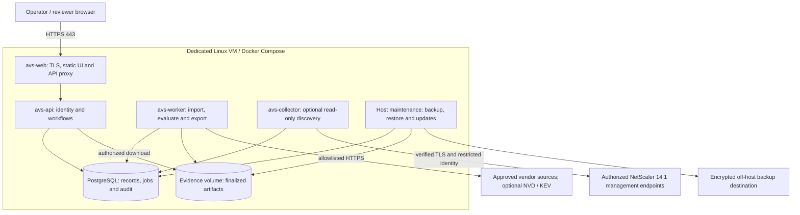

# AVS technical architecture and product design

Version 0.2 · Proposed implementation baseline · 24 November 2026

## 1. Recommended architecture

Deliver AVS as a locally hosted Linux application, packaged as versioned container images and a Docker Compose deployment bundle. Use a dedicated Linux VM with persistent storage, an internal DNS name and an organization-issued TLS certificate. No cloud subscription, external AI service or container orchestration cluster is required.

Start with NetScaler ADC and Gateway 14.1 only. Build shared assessment, evidence and lifecycle modules around explicit product adapters so additional versions and products can be added later. This is a design proposal: the repository currently contains documentation, not an implemented appliance or validated support.

The first engineering increment remains an offline CLI assessment against reviewed fixtures. The first packaged user release adds the browser interface and local services described here. Read-only discovery is a subsequent lab-validated capability. Production changes require a separate pilot decision.

## 2. Product purpose and scope

AVS helps infrastructure and security teams answer: which assets are affected by an advisory, what evidence supports that conclusion, what action is available, and has remediation been verified?

For a Citrix environment, the initial value is NetScaler ADC and Gateway exposure visibility, faster advisory assessment, clearer patch priorities and traceable change preparation. Citrix Virtual Apps and Desktops, StoreFront and Delivery Controllers would require separate future adapters and validation.

| Outcome | Operator benefit | Measure |
|---|---|---|
| Match advisories to build and configuration | Reduce manual applicability checks | Paired manual and AVS assessment times |
| Explain affected, not affected and indeterminate outcomes | Direct investigation toward missing facts and affected assets | Reviewed reasons and timestamped inventory |
| Surface vendor-documented temporary options | Prepare a controlled response while arranging a patch | Vendor reference, prerequisites and expiry |
| Preserve review and remediation evidence | Reduce repeated change and audit preparation | Reproducible export linked to inputs and owner |
| Reassess after source or asset changes | Reveal stale conclusions and incomplete remediation | Invalidation history and patch verification |

The first release provides assessment and evidence. It does not intercept traffic or automatically block exploitation. Temporary controls are available only when supported by vendor documentation and applicable evidence. Firmware modifications, inline proxying, kernel integrations and unattended production remediation remain outside the baseline.

| Increment | Included | Exit boundary |
|---|---|---|
| M1 offline core | Sanitized imports, advisory revisions, deterministic evaluation, JSON and human-readable exports | Ten-advisory reviewed NetScaler 14.1 corpus and product thresholds |
| Local packaged release | Linux Compose bundle, browser workflows, authentication, durable jobs and backups | Clean-host installation, restart and restore verified |
| M2 discovery | Optional collector with approved read operations | Exact-build/profile inventory parity and permission checks |
| M3 lab evidence | Reviewed control catalog, configuration checks, synthetic workflow and rollback evidence | Security and appliance-owner acceptance |
| M4 pilot decision | Approved production boundary and operator-led change | Explicit go/no-go |
| Later expansion | Additional NetScaler trains, then selected other products | Separate coverage rows and capability gates |

The packaged UI and operational requirements add work to the original milestone scope. Re-estimate them before committing to a delivery date.

## 3. Deployment options

| Approach | Fit | Decision |
|---|---|---|
| Dedicated Linux VM + Docker Compose | One site, one operating team and controlled updates | Recommended first distribution |
| Linux + rootless Podman + Quadlet | Teams standardizing on Podman and systemd | Later package using the same images; test separate units |
| Native packages + systemd | Containers prohibited | Possible later; additional host dependency and upgrade work |
| Kubernetes | Existing managed cluster or demonstrated multi-node requirement | Defer until availability or scale justifies it |
| Prebuilt VM image | Customers needing an appliance import experience | Later wrapper around the same containers; adds OS/hypervisor maintenance |

Docker documents Compose for single-server production deployment. This supports the packaging recommendation; it does not provide host failover. A host outage interrupts AVS until recovery. [Docker production guidance](https://docs.docker.com/compose/how-tos/production/).

Podman Quadlet translates declarative container definitions into systemd services and supports rootless use. Treat it as a separately qualified package rather than assuming identical Compose behavior. [Podman Quadlet documentation](https://docs.podman.io/en/latest/markdown/podman-systemd.unit.5.html).

Proposed initial qualification target: Ubuntu Server 24.04 LTS, x86-64. Record tested OS, kernel, Engine and Compose versions in each release manifest. Other distributions and ARM64 remain candidates until qualified. Keep AVS on its own VM, separate from the NetScaler appliance.

## 4. Deployment and component boundaries



The arrows represent permitted logical flows. Container network membership does not enforce destination restrictions by itself; use host and upstream firewall rules. In disconnected mode, import reviewed files and optionally leave collection disabled.

Use a modular application with separate runtime processes. API and worker share versioned domain packages; the collector gets a separate image and minimal permissions. Avoid independent business microservices until their operational benefit is demonstrated.

| Component | Proposed technology | Responsibility |
|---|---|---|
| Browser UI | React, TypeScript, Vite | Inventory, exposure review, evidence and system status |
| Web edge | NGINX | TLS, static assets, bounded uploads and API proxy |
| API | Python, FastAPI | Authentication, server-side authorization and versioned REST contract |
| Domain packages | Typed Python schemas and deterministic rules | Identity, applicability, evidence lineage and lifecycle |
| Persistence | PostgreSQL; SQLAlchemy/Alembic proposed | Transactions, immutable revisions, migrations and jobs |
| Worker | Dedicated Python process | Imports, evaluation, reports, expiry and scheduling |
| Collector | Dedicated Python image/process | Approved read-only requests and normalized snapshots |
| Evidence store | Local persistent filesystem | Content-addressed exports, sources and lab attachments |
| Host operations | Versioned scripts and systemd integration | Preflight, boot, diagnostics, backup, restore and updates |

FastAPI documents application-specific container images. React documents Vite as a build option and notes the additional responsibility for routing and data fetching. A static internal UI with a separate API avoids requiring Node.js on the installed appliance. Lock tested dependencies during implementation. [FastAPI containers](https://fastapi.tiangolo.com/deployment/docker/), [React build guidance](https://react.dev/learn/build-a-react-app-from-scratch).

PostgreSQL and filesystem artifacts are sufficient initially. Add Redis, an external broker or object storage only when measured needs justify them. External AI is optional and disabled by default. Deterministic rules own applicability.

## 5. Product design and workflows

Navigation: Overview, Assets, Advisories, Assessments, Controls & Evidence, Reports, Coverage, Administration. Use textual status labels; color is supplemental.

| Screen | Main information | Primary action |
|---|---|---|
| Overview | Affected, indeterminate, unassessed and stale assets; overdue work; source/collection health | Open review queue |
| Assets | Product, exact build, features, role, owner, snapshot age and coverage | Import or request authorized collection |
| Advisories | Vendor source, revisions, CVEs, ranges and documented options | Request assessment |
| Assessment detail | Outcome, reasons, missing facts, rules, source and snapshot revisions | Investigate, assign owner or export |
| Controls & Evidence | Prerequisites, limitations, lab evidence, review and expiry | Review evidence and record operator-led change |
| Reports | Scope, job status, revision manifest and digest | Download authorized package |
| Coverage | Product/version/profile and capability validation status | Inspect limits and evidence |
| Administration | Identity, source allowlists, credential references, retention and health | Maintain site configuration |

Illustrative assessment detail, not a real finding:

```text
Asset: gateway-01           Product: NetScaler Gateway 14.1
Applicability: INDETERMINATE
Reason: required configuration evidence missing
Snapshot: <observed time>   Freshness: <current / stale>
Advisory: <vendor ID / revision / source link>
Missing facts: <named required configuration facts>
Temporary option: <documented / none documented / unverified>
Remediation: <owner / target date / verification status>
Actions: Review facts | Request collection | Export evidence
```

No Apply action or arbitrary command console appears in the initial release. Empty views explain the next step. A failed refresh retains the last valid snapshot with its age visible. A zero affected count always appears alongside indeterminate and unassessed counts.

1. Administrator configures identity, certificates, retention and approved sources.
2. Operator imports sanitized inventory or requests collection against an approved target and credential reference.
3. Worker ingests revisions and evaluates snapshots against validated rules.
4. Reviewer checks reasons, resolves missing facts and assigns remediation ownership.
5. Where documented options exist, the team reviews prerequisites and lab evidence through its existing change process.
6. Operator performs the separately approved patch or control change and records its ticket.
7. Fresh inventory and agreed health checks establish remediation evidence; temporary controls are retired through the approved process.

## 6. Data contracts and evidence

| Entity | Minimum contract |
|---|---|
| Asset | Stable pseudonym, product identity, owner, site and approved target reference |
| ApplianceSnapshot | Asset ID, train, exact/original build string, features, profile, HA member/pair, observed time, source and completeness |
| AdvisoryRevision | Source identity/URL, advisory/CVE IDs, source/retrieval dates, digest, product constraints, options and precedence |
| RuleRevision | Product constraints, typed predicates, references, parser/comparator revision, review state and digest |
| CoverageRow | Product, train, build range, deployment/feature profile, capability status, lifecycle source/check date, owner and evidence |
| Assessment | Advisory, snapshot, rule/evaluator/adapter and coverage revisions, outcome, reasons, missing fields and timestamp |
| ControlRevision | Vendor reference, product/version/profile constraints, typed parameters, prerequisites, limitations, expiry and digest |
| EvidenceRun / Artifact | Input revisions, lab environment, scenarios, results, digest, artifact locator, time and reviewer |
| Review / ChangeRecord | Actor, decision, immutable digest, asset scope, expiry, ticket and observed outcome |
| Job / AuditEvent | Typed inputs, idempotency key, lease, attempts and status; actor/action/resource/time/reason |

Use stable IDs, UTC, explicit schemas and foreign keys. Historical revisions remain immutable. New sources or snapshots create new assessments and invalidate related active reviews rather than rewriting history. Reports include pinned inputs and rule revisions for offline replay.

Initial approval records capture an authenticated, authorized reviewer's explicit decision, identity, timestamp and reason, bound to an immutable revision digest, asset scope and expiry. Check authorization, revision, scope, revocation and expiry whenever an approval is used. Cryptographic signing of approval artifacts is a later option; initial approval relies on authentication, authorization and audited application records.

Applicability is affected, not affected or indeterminate. Coverage, freshness, temporary-option availability, evidence status and remediation lifecycle are separate fields. Missing/conflicting required facts and unvalidated coverage produce indeterminate. Stale evidence cannot qualify a new approval or release gate.

Write artifacts to a temporary file, compute their digest, publish atomically and then commit metadata. Reconcile orphan files and missing references after failure. Incomplete artifacts cannot become approved evidence. Local hashes and application-level append-only permissions do not protect against a compromised host administrator; external audit copies or signed manifests offer additional assurance.

## 7. Product adapter model

A reviewed adapter supplies product identity/capability constraints, advisory and inventory normalization, version comparison, feature predicates, approved collection operations and control references. Proposed interfaces include normalize_inventory, normalize_advisory, compare_version, evaluate and collect_read_only.

Load adapters only from verified release packages. Never execute plugins, scripts or commands supplied through advisories or operator data imports. Offline and discovered inputs use the same schema. Keep product-specific semantics outside the shared lifecycle engine.

The first adapter covers ADC and Gateway 14.1 with explicit deployment and feature profiles. Preserve original build strings and use vendor-specific comparison fixtures. Do not assume semantic version ordering or reuse another train's fixed-build threshold.

The collector is expected to use NetScaler management APIs. Confirm exact endpoints, fields, session behavior and permissions against vendor documentation and lab builds before implementation. HTTP verbs alone do not establish read-only behavior: authentication may need a session operation, while collection must allow only reviewed reads. The built-in read-only policy excludes some configuration commands, so validate minimum required permissions rather than assuming complete configuration access. [NetScaler command policy documentation](https://docs.netscaler.com/us/en/citrix-adc/current-release/system/authentication-and-authorization-for-system-user/user-usergroups-command-policies.html).

Additional trains and products follow the [coverage policy](09-coverage.md). Shared vendor identity does not imply shared APIs, version semantics, safe controls or production authority.

## 8. API and durable execution

Proposed resources under `/api/v1`: assets, snapshots, advisories, assessments, controls, coverage, reports, jobs and audit events. Commands include import, collect, assess, review and export. Long operations return a job ID for polling. No production management-write endpoint is included.

Enforce schema and size limits, resource authorization, mutation audit and submission idempotency. Imports report row failures and partial completion. Downloads resolve authorized artifact IDs through metadata, never a browser-supplied filesystem path.

Use a PostgreSQL job table initially. Claim ready jobs in a short row-lock transaction using SKIP LOCKED; commit a lease before external work. PostgreSQL identifies queue-like consumers as an appropriate use while warning about inconsistent views for general queries. [PostgreSQL SELECT](https://www.postgresql.org/docs/current/sql-select.html).

Execution is at least once. Use unique result keys, idempotent steps, bounded retries and visible terminal failures. Leases have owner, generation and expiry; renew them during work and reject completion from stale generations. Reclaim expired work without keeping transactions open during network calls. A singleton scheduler lease and unique occurrence keys prevent duplicate scheduling. Serialize collection per appliance/HA pair and cap global concurrency.

Proposed lab defaults: one request at a time per target, two simultaneous target collections, ten-second request timeout, two retries for safe reads and a five-minute collection deadline. Permission, authentication and schema errors need review rather than repeated retries. Freshness thresholds and schedules are visible site policy.

## 9. Network, identity and secrets

| Flow | Access | Boundary |
|---|---|---|
| Browser to web | Internal HTTPS 443 | Authorized user networks only |
| Web to API | Private service network | Trust proxy headers only from configured edge |
| API/worker/collector to PostgreSQL | Private database network | No published DB port; separate restricted DB roles |
| Worker to sources | Allowlisted HTTPS/proxy | No arbitrary fetches from advisory links |
| Collector to appliances | Approved management destinations and verified TLS | Firewall allowlist and restricted appliance identity |
| Host to backup target | Approved encrypted transfer | Separate access and retention |
| Administrator to host | Restricted management channel | Audited host administration |

Use separate edge, service and database networks, plus host/upstream destination policy. Only the collector receives appliance credentials and management egress. The API stores opaque credential reference names. A host administrator provisions or rotates secret files; the initial UI selects an existing reference. Worker and web containers receive no appliance credentials.

Check destination policy after DNS resolution and redirects. The collector can access explicitly configured internal ranges; reject unrelated loopback, link-local and metadata addresses. Source fetching has a separate public-source allowlist. Validate TLS against the site's CA bundle; trust failures remain visible and do not disable verification.

Provide named local accounts for disconnected labs, with strong password hashing, throttling, session expiry and controlled recovery. Integrate organization OIDC and MFA for shared deployments. Validate issuer, audience, state and nonce; use secure HttpOnly same-site cookies, CSRF controls and server-side role enforcement. Viewer, operator, reviewer and administrator roles remain distinct. Pilot reviewers cannot approve their own changes. Application administration does not confer host or appliance administrator rights.

Use file-mounted secrets with restricted host ownership and encrypted disk/backup storage. Compose secrets are per-service file mounts, not an encrypted vault. Keep source files out of source control, images, logs and exports. [Docker Compose secrets](https://docs.docker.com/compose/how-tos/use-secrets/).

Protected local files are the accepted initial secret-storage baseline. Mount secret files read-only only into services that require them and verify permissions under the configured container UID mapping. A later vault integration can resolve the same opaque credential references through a provider boundary, without changing assessment or report contracts. Vault availability is not a dependency of the initial release.

Run applications as non-root, drop capabilities, prohibit privilege escalation and set resource limits. Use read-only root filesystems where compatible with explicit writable storage. Never mount the Docker socket. Evaluate rootless Docker during qualification; it also runs the daemon without root but has host prerequisites. [Docker rootless mode](https://docs.docker.com/engine/security/rootless/).

## 10. Storage, backup and restore

| Data | Proposed location | Requirement |
|---|---|---|
| Non-secret configuration and manifest | `/etc/avs` | Versioned backup |
| Secret source files | Restricted `/etc/avs/secrets` | Encrypted and separately controlled backup |
| PostgreSQL | Persistent local volume | Consistent database backup, not a live file copy |
| Finalized artifacts | `/var/lib/avs/evidence` | Matching artifact set and digest verification |
| Backup staging | Restricted `/var/backups/avs` | Encrypted transfer off host |
| Logs | Runtime-managed bounded logs | Rotation; optional external audit destination |

Use explicit volumes and ownership, including rootless UID mapping where relevant. Check mount persistence and free space before initialization. Retention coordinates metadata and files; active reviews and retained reports prevent deletion of referenced evidence.

For initial coordinated backups: enter maintenance mode, block mutations/scheduling, drain worker and collector jobs, take a PostgreSQL dump and copy the matching artifacts/configuration. Record schema/application versions, image digests and checksums in the encrypted manifest. Resume only after the snapshot set is complete. Database roles and deployment configuration need separate capture from the database dump. [PostgreSQL pg_dump](https://www.postgresql.org/docs/current/app-pgdump.html).

Restore on an isolated host using the compatible recorded release. Restore configuration, roles, database, evidence and secrets; check digests, historical replay and report download. Reset expired job leases. Keep collection/schedules disabled until an operator confirms targets and identity. Rehearse before release.

Proposed targets: daily off-host backups, 24-hour RPO and four-hour RTO, validated through measured recovery. Tighter objectives need additional backup frequency or a later WAL/object-storage design. Restart policies provide process recovery, not multi-host availability.

## 11. Installation, offline operation and updates

Ship verified image references, offline image archives, Compose files, example settings, migrations, administrator instructions, maintenance tools, checksums, signatures, SBOM and release notes. Verify signatures against a key trusted independently of the archive.

Preflight checks cover OS/runtime, resources, volumes, time synchronization, DNS, certificates, routes and permissions. Import/pull verified images, run one migration job and require named-administrator setup. No shared default credentials; disable bootstrap enrollment once complete. Host-run migration jobs use separate narrowly scoped credentials.

Use a tested systemd startup unit plus container restart policies. Health checks order startup; applications must reconnect after runtime dependency failures. Container health does not establish fresh sources or validated coverage.

Connected mode refreshes approved sources through an optional proxy. Disconnected mode imports reviewed advisory/inventory bundles with schemas, provenance, dates and digests. Verify signatures when available and identify operator-reviewed trust otherwise. Complete offline installations require no runtime dependency download.

NVD and KEV provide context; vendor build and configuration statements drive applicability under explicit precedence rules. Conflicts and parser failures stay visible. Retain the last valid revision with its age and create a review task. Reproducible offline reports do not imply current advisory coverage.

Updates are explicit: maintenance window, coordinated backup, compatible image set, migration check and smoke tests. Avoid `latest` tags and automatic unreviewed updates. Define schema compatibility per release. If a migration is not safely reversible, recover the prior release and complete pre-upgrade backup; restarting an older image alone is insufficient. Preserve and test the previous bundle.

## 12. Capacity, monitoring and acceptance

Initial test envelope: one site, 50 managed assets, five concurrent reviewers and 90 days of online history. Begin testing at 4 vCPU, 8 GB RAM and 100 GB usable SSD plus off-host backup capacity. These are planning assumptions, not validated sizing; artifact retention may dominate disk use.

Proposed targets: metadata views within two seconds at the 95th percentile under the agreed load, and evaluation of 50 assets against the ten-advisory corpus within five minutes excluding collection/fetch time. Publish limits only after measurement.

Separate liveness from readiness. Track queue age, lease expirations, failed imports, collection age, source freshness, indeterminate reasons, artifact integrity, disk usage and backup age. Use structured logs with job/request IDs and redacted asset identifiers. Protect diagnostics and metrics. Support bundles omit credentials, raw configurations and production identifiers by default.

Show degraded states for database failure, stale sources, unavailable collector, disk pressure and overdue backup. Stop artifact-producing jobs safely at configured disk thresholds. An optional monitoring stack can follow; basic diagnostics belong in the initial package.

| Release evidence | Required checks |
|---|---|
| Correctness | Independent labels, build boundaries, missing/conflicting inputs and cross-product isolation |
| Reproducibility | Replay pinned inputs and rules with matching outcome/manifest |
| User workflow | Import, review missing facts, assign, export and record remediation; API authorization tested |
| Discovery | Exact-build parity, denied writes, trusted TLS, partial snapshots and HA profiles |
| Jobs | Mid-job worker failure, lease reclaim, stale completion rejection and idempotent finalization |
| Deployment | Clean Linux install, offline bundle, boot recovery and expected exposed ports |
| Recovery | Coordinated backup, isolated restore, digest checks and measured RPO/RTO |
| Upgrade | Compatibility, migration failure handling, smoke checks and previous-release recovery |
| Security | Authorization, malformed data, destination policy, redaction and release integrity |
| Capacity | Workload, growth, resource limits and safe disk/concurrency behavior |

The [verification plan](06-verification.md) defines advisory and lab criteria. Deployability and recovery evidence do not establish exploitation prevention or production change authority.

## 13. Implementation order and open decisions

1. Define typed schemas, the NetScaler 14.1 adapter and reviewed fixtures. Deliver CLI-to-report first.
2. Add PostgreSQL revisions, leased jobs and filesystem artifact integrity around the same evaluator.
3. Add API/browser workflows, identity modes and authorization.
4. Qualify Compose packaging, offline images, boot, coordinated backups and updates on Linux.
5. Add the isolated collector after exact endpoint/privilege validation in the authorized lab.
6. Add temporary-control lab evidence and review, then hold the separate pilot decision.
7. Select and validate another NetScaler train before an additional vendor product; estimate each expansion.

Before implementation, settle tested runtime versions, identity provider, exact initial builds/deployment forms, refresh policy, retention, capacity limits and backup destination. The product owner and delivery lead must rebaseline UI and operational delivery effort. Maintain one supported runtime package initially; qualify Podman or a VM image when demand warrants another release/recovery matrix.

This document supersedes the earlier proposal to defer storage and the UI indefinitely. Keep the offline milestone small while delivering a locally operated Linux product with a tested recovery path.
