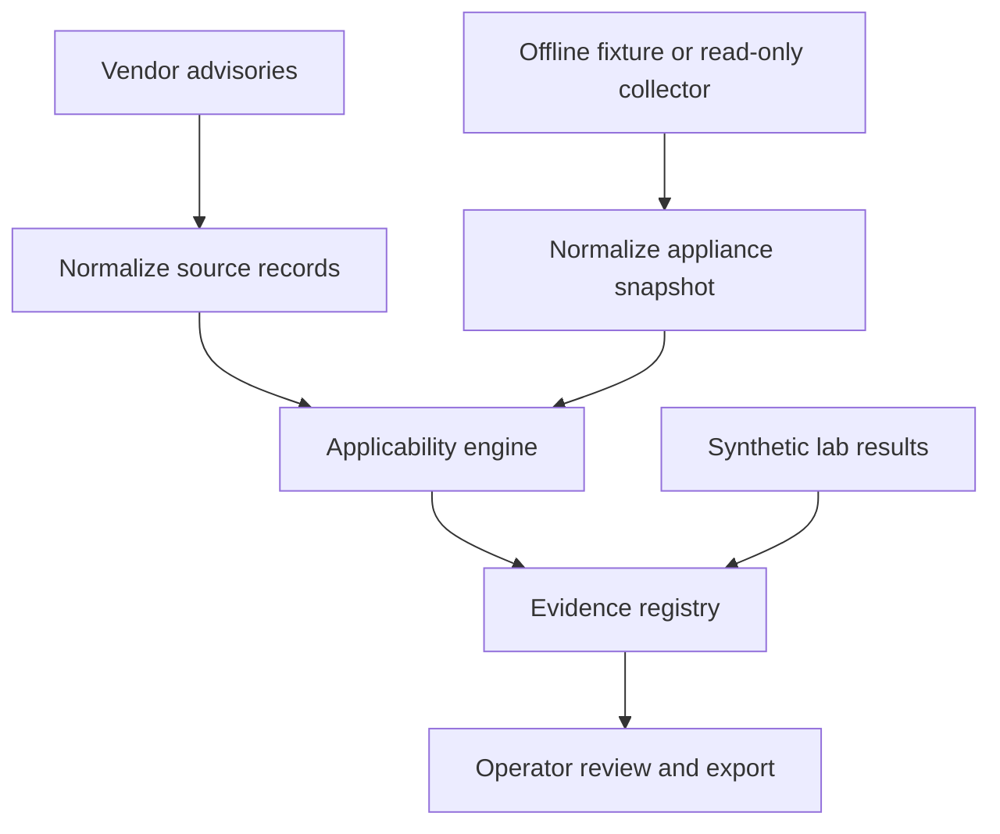

# Technical architecture

## Proposed deployment

Start with a single Python service or CLI against replayable fixtures. Introduce FastAPI and PostgreSQL when concurrent review, durable evidence, or integration access requires them. A Next.js UI follows validated review workflows. Evaluate Entra ID, Azure Key Vault and Bicep for a hosted MVP once deployment ownership is settled. Keep CI provider selection open until the repository is accessible.

## Data and service boundaries

| Entity | Minimum contract |
|---|---|
| AdvisoryRevision | Source URL, advisory and CVE IDs, retrieved time, revision hash, vendor/product identity, affected release trains and builds with source precedence, documented options |
| ApplianceSnapshot | Asset pseudonym, vendor, product, release train, build, relevant feature flags, profile, HA metadata, source and observed time |
| Assessment | Advisory revision ID, snapshot ID, evaluator version, outcome, reason codes and missing fields |
| ControlRevision | Vendor reference, control catalog ID, vendor/product and version constraints, target profile, typed parameters, prerequisites, expiry and digest |
| EvidenceRun | Control or assessment revision, fixture ID, environment, timestamp, scenario results and artifact digest |
| Approval / change record | Reviewer, operator, approved digest, target scope, change ticket, timestamps and outcome |

Treat advisory text and imported inventory as untrusted data. Preserve source provenance and validate schemas at ingest. Dispatch through a versioned product adapter registry using normalized vendor and product identity. Each adapter owns advisory mapping, version comparison, feature semantics, discovery and control catalog bindings. Compare builds with product-specific version handling and boundary fixtures; do not assume shared ordering across vendors or release trains. Include adapter revision and coverage matrix row in assessment inputs and exports. Unknown or unvalidated combinations produce indeterminate. Make repeat processing idempotent on source identity and content digest. Persist assessment inputs so a reviewer can reconstruct the original result. Serialize any future authorized change per appliance pair and reconcile observed state after ambiguous failures.

**Read-only collector.** Isolate management connectivity. Version the adapter by supported build train, set bounded timeouts and retries for reads, and distinguish permission failures, unsupported capabilities and incomplete collection. Verify exact read endpoints, roles, licensing and HA semantics against vendor documentation and lab devices before implementation. Offline inputs use the same normalized contract.

**AI boundary.** Optional advisory summarization and retrieval from a curated catalog may assist reviewers. Deterministic logic owns build applicability. Treat model output as untrusted draft text. Use sanitized inputs and preserve source citations. Exclude appliance credentials, arbitrary tool execution and management-plane permissions.

**Future pilot boundary.** A separate narrowly permissioned process can apply only a reviewed, signed control revision after checking change ticket, expiry, current state and approved scope. Run vendor-approved changes in the lab first. The pilot design must prove auditability, change ordering and recovery before production access is enabled.
